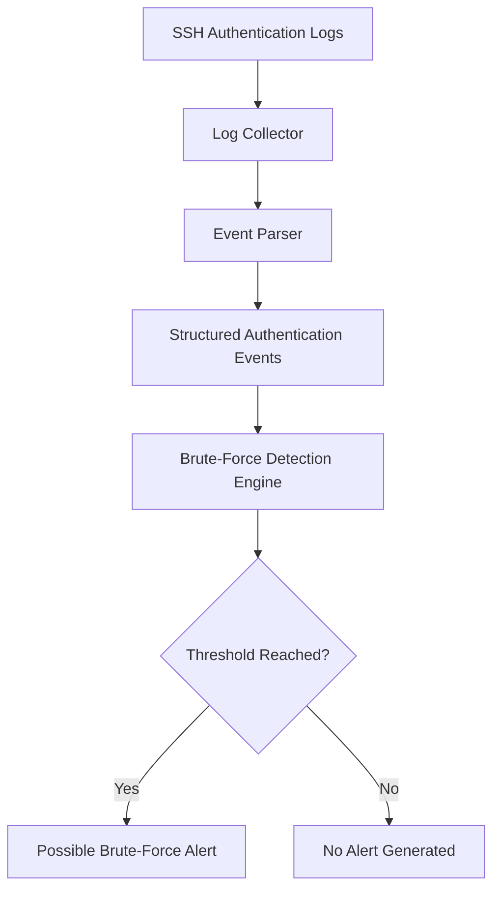

# KingaWatch

### SSH Threat Detection & Authentication Intelligence

**Turning authentication logs into actionable security intelligence.**

KingaWatch is an open-source cybersecurity project focused on analysing SSH authentication activity and identifying suspicious login behaviour.

It is being engineered as a lightweight security monitoring and detection platform, with a particular focus on the practical workflows used by Security Operations Centre (SOC) analysts.

The project transforms raw authentication log entries into structured security events, analyses those events for suspicious patterns, and generates alerts that can support further investigation.

Rather than simply displaying log data, KingaWatch aims to demonstrate how security telemetry can be collected, interpreted, investigated and turned into useful detection outcomes.

---

## 1. The Security Problem

SSH is widely used to remotely access and administer Linux systems. Because authentication services are exposed to potential attackers, they can become targets for:

- Brute-force password attacks.
- Repeated unauthorised login attempts.
- Attempts to access accounts using invalid usernames.
- Suspicious authentication activity from remote IP addresses.

A system administrator or SOC analyst needs more than a collection of log entries. They need a way to identify patterns that may indicate malicious activity.

**KingaWatch addresses this challenge by building an extensible authentication monitoring and detection engine.**

## 2. How It Works

The current processing pipeline follows four stages:

1. **Log collection** – reads SSH authentication log files.
2. **Event extraction** – identifies recognised authentication events and extracts relevant fields.
3. **Detection** – analyses failed login attempts and identifies IP addresses exceeding a configurable threshold.
4. **Alert generation** – produces structured alerts for possible brute-force activity.



## 3. Implemented Capabilities

The current version includes:

| Component | Capability |
|---|---|
| Log collector | Reads authentication log files |
| Event parser | Extracts timestamps, hostnames, usernames and source IP addresses |
| Event classification | Identifies failed and successful SSH logins |
| Detection engine | Counts failed attempts by source IP |
| Threshold validation | Rejects invalid detection thresholds |
| Automated tests | Verifies collector and detector behaviour |

### Current Detection Rule

KingaWatch currently implements a basic SSH brute-force detection rule.

- Default threshold: **5 failed login attempts**.
- Detection key: source IP address.
- Event type counted: failed SSH login.
- Successful logins: not counted as failed attempts.
- Alert classification: `possible_brute_force`.

An alert represents suspicious behaviour requiring investigation. It is not definitive proof of an attack.

## 4. Technology Stack

- **Python 3** – event processing and detection logic.
- **Ubuntu Linux (WSL2)** – development and testing environment.
- **Git and GitHub** – version control and project collaboration.
- **SSH authentication logs** – security telemetry.
- **Python unittest** – automated testing.

The current implementation uses Python's standard library and does not require third-party packages.

## 5. Project Structure

```text
kingawatch/
├── config/
│   └── rules.json
├── data/
│   └── sample_auth.log
├── reports/
├── src/
│   └── kingawatch/
│       ├── __init__.py
│       ├── collector.py
│       ├── detector.py
│       ├── normalizer.py
│       ├── scorer.py
│       ├── evidence.py
│       ├── storage.py
│       └── main.py
├── tests/
│   ├── test_collector.py
│   └── test_detector.py
├── .gitignore
├── requirements.txt
└── README.md
```

Some modules and directories are currently reserved for future development.

## 6. Getting Started

### Requirements

- Linux, Ubuntu or WSL2.
- Python 3.
- Git.

### Clone the repository

```bash
git clone https://github.com/masanyatonny-maker/kingawatch.git
cd kingawatch
```

### Run the automated tests

```bash
PYTHONPATH=src python3 -m unittest discover -s tests -v
```

The current test suite contains eight tests covering log collection, event parsing and brute-force detection.

### Run the current detection pipeline

```bash
PYTHONPATH=src python3 -c 'from kingawatch.collector import collect_events; from kingawatch.detector import detect_brute_force; events = collect_events("data/sample_auth.log"); alerts = detect_brute_force(events); print(f"Events collected: {len(events)}"); print(f"Alerts generated: {alerts}")'
```

The supplied sample log currently produces three recognised authentication events and no brute-force alert at the default threshold.

## 7. Detection Limitations

The current detection engine is intentionally simple. Its limitations include:

- It counts attempts across the entire input file rather than within a defined time window.
- It groups attempts by source IP, without considering additional behavioural context.
- It does not currently enrich IP addresses with threat intelligence.
- It does not yet correlate authentication activity across multiple log sources.
- Generated alerts are not yet stored or assigned severity scores.

These limitations provide concrete opportunities for improving the detection engine.

## 8. Development Roadmap

KingaWatch is being developed incrementally, with each capability implemented and tested before being considered complete.

**Phase 1 — Authentication Monitoring**
- SSH log collection.
- Authentication event parsing.
- Basic brute-force detection.
- Automated unit tests.

**Phase 2 — Detection Engineering**
- Time-based detection windows.
- Configurable detection rules.
- Additional suspicious authentication patterns.
- Improved event normalisation.

**Phase 3 — Threat Analysis**
- Alert severity scoring.
- Evidence collection.
- Event correlation.
- More detailed detection context.

**Phase 4 — SOC Investigation**
- Alert storage.
- Investigation-ready reports.
- Terminal-based analyst interface.
- Improved alert management.

**Phase 5 — Advanced Capabilities**
- Expanded log-source support.
- Additional detection techniques.
- Detection performance evaluation.
- Comprehensive technical documentation.

Roadmap items will be marked as implemented only after they have been developed and tested.

## 9. Engineering Approach

KingaWatch is developed using a practical learning and engineering process:

**Learn → Explore → Practise → Build → Test → Document**

The project emphasises understanding the underlying security concepts, writing maintainable code, validating detection logic, and documenting technical decisions.

The objective is to build a credible demonstration of practical skills in:

- Linux system administration.
- Python programming.
- Network and authentication security.
- Log analysis.
- Detection engineering.
- SOC investigation workflows.
- Software testing and version control.

## 10. Project Status

KingaWatch is an active work in progress.

The authentication log collector, event parser and initial brute-force detection engine are implemented. The automated test suite currently contains eight passing tests.

Further capabilities are being developed progressively.

---

**Author:** Ombogo Tonny

**Repository:** https://github.com/masanyatonny-maker/kingawatch

**Project:** KingaWatch — SSH Threat Detection & Authentication Intelligence
